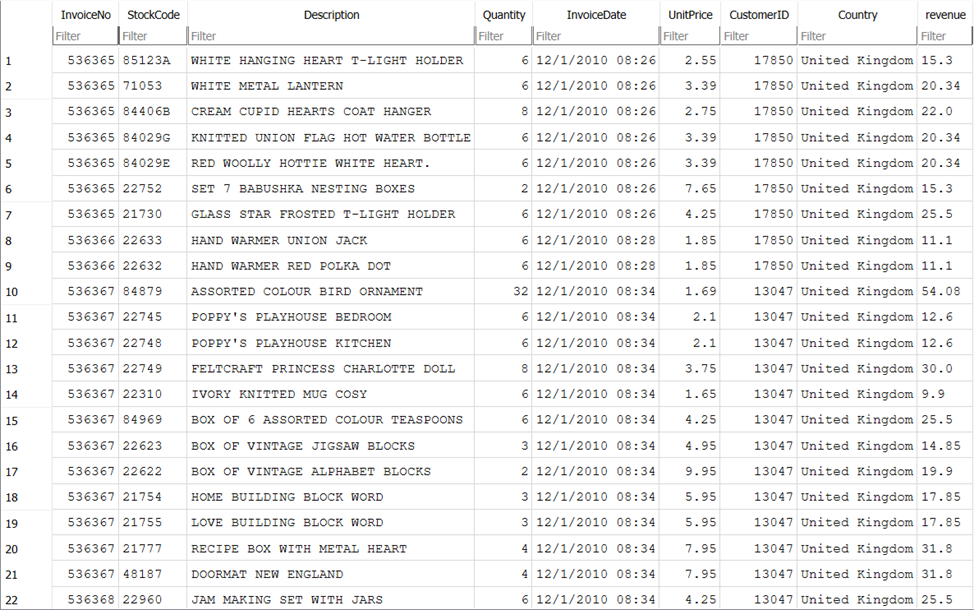
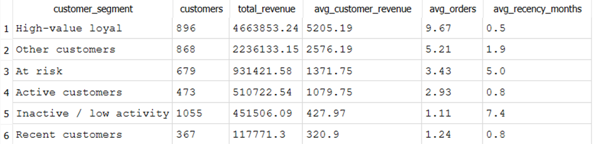
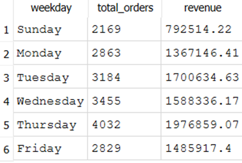
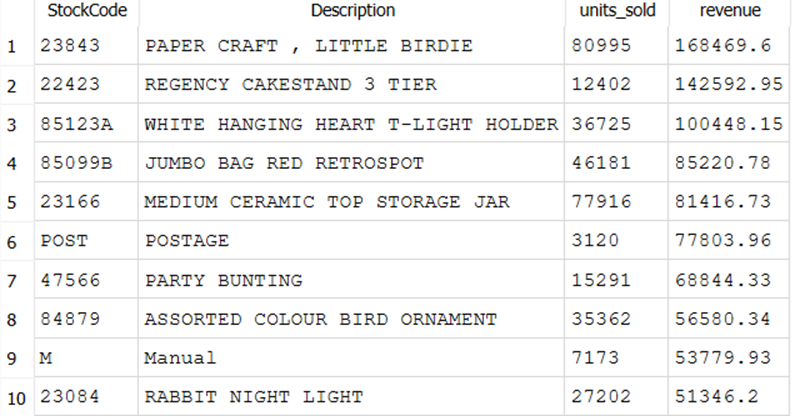
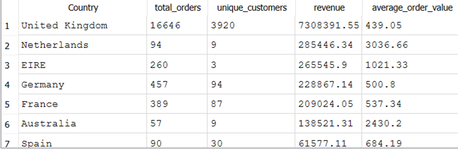

# E-Commerce Sales Performance & RFM Customer Segmentation

End-to-end SQL analytical project built on transactional retail data (`Online_Retail_3`, Dec 2010 – Dec 2011) in **SQLite**. Includes data quality auditing, a reusable `clean_sales` view, revenue and AOV tracking across time and geographies, weekday sales analysis, top products/customers, and a 5-stage **RFM (Recency, Frequency, Monetary)** customer segmentation model.

> **Author:** Danil Fedoseenko 
> **GitHub:** https://github.com/Dani-kley/ecommerce-rfm-sql-analysis  
> **LinkedIn:** https://www.linkedin.com/in/danil-fedoseenko/
> **Full Case Study Report (PDF):** [`docs/RFM_Case.pdf`](docs/RFM_Case.pdf)

---

## Key Highlights

- **Net Revenue:** **$8,911,407.90** across **18,532 orders** and **5,167,812 units sold** (`397,884` valid rows out of `541,909` raw rows).
- **Average Order Value (AOV):** **$480.87** overall, peaking in Q4 2011 (Oct: **$1.04M**, Nov: **$1.16M**).
- **Geographic Split:** The UK drives **82.0%** of revenue (`$7.31M`), while international wholesale markets such as the Netherlands (**$3,036.66 AOV**) and Australia (**$2,430.20 AOV**) show much higher basket sizes.
- **Customer Pareto Effect:** **896** `High-value loyal` customers (**20.7%** of active users) generate **52.3%** of total revenue (**$4.66M**), averaging **9.67 orders** and **$5,205.19** spend per customer.

---

## Tech Stack & SQL Techniques

- **Database:** SQLite 3
- **SQL Features:** Common Table Expressions (CTEs), Window Functions (`NTILE(5) OVER (...)`), Views (`CREATE VIEW clean_sales`), Conditional Aggregations (`CASE WHEN`), Date/String Parsing (`SUBSTR`, `INSTR`, `strftime`, `printf`)

---

## Repository Structure

```text
├── README.md
├── LICENSE
├── docs/
│   └── RFM_Case_Study.pdf              # Detailed case study report with business recommendations
├── sql/
│   ├── control_data.sql                # Raw data anomaly checks (NULL CustomerID, cancellations, etc.)
│   ├── cleandata_and_revenue.sql       # Reusable clean_sales view & line-item revenue calculation
│   ├── Overall_sales.sql               # Headline sales & customer metrics
│   ├── avarage_order_value_bymounth.sql# Monthly revenue, orders, and AOV trend
│   ├── revenue_by_weekday.sql          # Revenue & orders by day of week
│   ├── sales_by_country.sql            # Revenue, customers, and AOV by country
│   ├── top_products.sql                # Top 10 SKUs by net revenue
│   ├── top_customers.sql               # Top 10 customers by total spend
│   └── RFM.sql                         # 5-stage RFM scoring & segmentation
└── screenshots/
    ├── clean_data.png
    ├── rfm_segmentation.png
    ├── revenue_by_weekday.png
    ├── top_products.png
    └── sales_by_countries.png
```

---

## Data Cleaning & Audit Summary

Raw transactional logs (`541,909` rows) were audited prior to metric calculation:
- **Missing `CustomerID` (`IS NULL`):** `135,080` rows excluded from customer-level analysis.
- **Cancelled invoices (`InvoiceNo LIKE 'C%'`):** `9,288` rows excluded.
- **Negative quantities (`Quantity < 0`):** `10,624` rows excluded.
- **Invalid prices (`UnitPrice <= 0`):** `2,517` rows excluded.
- **Result:** `397,884` clean records (`73.4%` of raw rows) unified in the `clean_sales` view.

---

## RFM Segmentation Overview (`4,338` Customers)

| Segment | Rule Logic | Customers | Total Revenue ($) | Avg Spend ($) | Avg Orders | Avg Recency |
| :--- | :--- | ---: | ---: | ---: | ---: | ---: |
| **High-value loyal** | `R>=4, F>=4, M>=4` | 896 | 4,663,853.24 | 5,205.19 | 9.67 | 0.5 mo |
| **Other customers** | Mid-tier / mixed | 868 | 2,236,133.15 | 2,576.19 | 5.21 | 1.9 mo |
| **At risk** | `R<=2, F>=3` | 679 | 931,421.58 | 1,371.75 | 3.43 | 5.0 mo |
| **Active customers** | `R>=4, F>=3` (`M<4`) | 473 | 510,722.54 | 1,079.75 | 2.93 | 0.8 mo |
| **Inactive / low activity** | `R<=2, F<=2` | 1,055 | 451,506.09 | 427.97 | 1.11 | 7.4 mo |
| **Recent customers** | `R>=4, F<=2` | 367 | 117,771.30 | 320.90 | 1.24 | 0.8 mo |

---

## Query Execution Screenshots

### Data Cleaning & `clean_sales` View


### RFM Customer Segmentation


### Revenue by Weekday


### Top Products by Revenue


### Sales by Country


---

## Next Steps & Improvements

- Move `max_month` out of the correlated scalar subquery into a standalone CTE for better scalability on larger tables.
- Standardize all reporting queries to reference `clean_sales` directly instead of repeating filter predicates.
- Add an explicit segment for high-monetary one-time/low-frequency buyers (`M=5, F<=2`).

---

## License & Ownership

© 2026 Danil Fedoseenko. All Rights Reserved. See [`LICENSE`](LICENSE) for terms.
